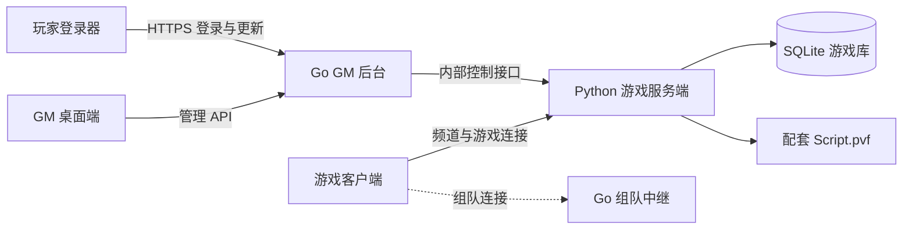

<div align="center">
  
  <h2>一套可自建的 90 版本游戏服务</h2>
  <p>频道与副本、玩家登录与更新、GM 管理与组队中继</p>
  <p><code>Windows</code> · <code>Python 3.12.10</code> · <code>Go 1.26</code> · <code>WPF / .NET 6</code></p>
  <p><a href="#项目一览">项目一览</a> · <a href="#服务架构">服务架构</a> · <a href="#快速开始">快速开始</a></p>
</div>

---

## 项目一览

90USDFO 将游戏服务端、玩家登录器和 GM 后台的明文源码放在同一仓库。搭建者可为自己的实例配置服务器地址、HTTPS 证书和管理权限。

| 组件 | 功能 | 源码 |
| :--- | :--- | :--- |
| **游戏服务端** | 账号会话、频道与角色、城镇和副本、PVF 资源加载与游戏数据存储 | [Python 服务](server_proto) · [Windows 辅助模块](server-pack-win10) |
| **玩家登录器** | 注册与登录、公告、CDK 兑换、补丁更新及游戏启动 | [WPF 界面](player_launcher/wpf) · [Go 启动程序](player_launcher/bootstrap) · [桥接模块](player_launcher/bridge) |
| **GM 后台** | 账号与角色管理、邮件与奖励发放、CDK、公告及操作审计 | [管理服务与桌面端](gm_manager) |
| **组队中继** | 为组队连接提供托管中继，支持 UDP 与安全 WebSocket 传输 | [Go 中继](party_relay) |

## 服务架构



玩家登录接口和 GM 管理接口可分别监听。玩家通过登录器建立会话，再由游戏客户端连接频道和游戏服务。

## 快速开始

### 1. 准备运行环境

- **服务端**需要 Windows x64、CPython **3.12.10**，以及同版本的客户端、`Script.pvf`、运行资源、原生模块和已初始化的 SQLite 游戏库。
- **GM 和组队中继**使用 Go **1.26**。**WPF 登录器**使用 .NET **8 SDK** 构建，运行目标为 .NET **6 Windows x86**，原生辅助模块使用 x86 MSVC 编译。

### 2. 构建并启动

在仓库根目录打开 PowerShell。先查看服务端启动参数，按实例路径准备运行资源，并通过 `USDOF_PVF_PATH` 指定配套 PVF。使用以下命令在本机启动服务端：

```powershell
python .\server_proto\start.py --help
python .\server_proto\start.py --host 127.0.0.1 --control-host 127.0.0.1 --login-host 127.0.0.1
```

另开一个 PowerShell 窗口构建 GM，并在首次启动前生成本机配置。初始化会创建独立的管理令牌，默认监听 `127.0.0.1:17890`。

```powershell
.\gm_manager\构建GM.ps1
$gm = ".\gm_manager\构建输出"
& "$gm\gmserver.exe" -init -config "$gm\go-manager.json"
& "$gm\gmserver.exe" -config "$gm\go-manager.json"
```

<details>
<summary><strong>构建玩家登录器</strong></summary>

在 x86 MSVC 开发环境中编译 [Helper 内的原生辅助模块](player_launcher/wpf/Helper)，再构建 [GameAssistBridge.csproj](player_launcher/bridge/GameAssistBridge.csproj) 和 [DNFLogin.csproj](player_launcher/wpf/DNFLogin.csproj)。设置 `GameAssistBridgeOutput` 指向桥接输出目录，设置 `ClientProtectionSecretsSource` 指向实例自己的保护构建输入。

</details>

### 3. 配置连接

- **玩家**使用实例的 HTTPS 登录地址和配套证书。启用玩家入口时，在 GM 配置中填写 `launcher_listen`、`launcher_public_host`、`launcher_certificate`、`launcher_key`，并确保玩家可到达频道及游戏端口。
- **管理员**在 GM 桌面端填写实例的管理地址和管理令牌。启用 WinRM 运维时，通过 `USDOF_GM_WINRM_CREDENTIALS`、`USDOF_GM_WINRM_COMPUTER_NAME` 和 `USDOF_GM_DEPLOY_ROOT` 指定本地配置。
- **组队中继**可在 [party_relay](party_relay) 目录通过 `go build .` 构建。按实例配置需要的监听与公开端点。

> 仓库提供源码及构建入口。配套客户端、PVF、运行资源、实例数据库、证书私钥和管理令牌由搭建者单独准备。

